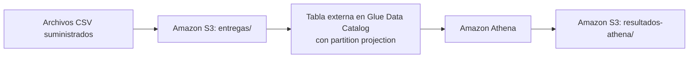

# Entrega Final — Consultas en Amazon Athena con Partition Projection

## 1. Contexto y arquitectura implementada

Una empresa de mensajería recibe archivos diarios CSV con los resultados de los intentos de entrega de paquetes y requiere consultar:
- La cantidad de intentos por fecha y estado.
- El porcentaje de entregas exitosas por fecha y ciudad.
- La duración promedio de las entregas exitosas para una fecha específica (`2026-10-02`).

Se implementó la siguiente arquitectura reproducible con **Terraform**, **Amazon S3**, **AWS Glue Data Catalog** (con *Partition Projection*) y **Amazon Athena**:



---

## 2. Prerrequisitos y configuración

- **Cuenta de AWS** con permisos para administrar S3, Glue Data Catalog y Amazon Athena.
- **AWS CLI v2** instalado y autenticado (`aws sts get-caller-identity`).
- **Terraform >= 1.5.0** instalado (`terraform --version`).
- **Región de despliegue:** `us-east-1`.

### Variables de configuración (`infraestructura/variables.tf`)

| Variable | Valor por defecto | Descripción |
| --- | --- | --- |
| `aws_region` | `us-east-1` | Región de AWS |
| `bucket_name` | `de-final-entregas-daniel-202610` | Bucket S3 privado para datos (`entregas/`) y resultados (`resultados-athena/`) |
| `glue_database_name` | `de_final_entregas_db` | Base de datos en Glue Data Catalog |
| `glue_table_name` | `entregas` | Tabla externa con Partition Projection (`2026-10-01,2026-10-03`) |
| `athena_workgroup_name` | `de_final_entregas_wg` | Workgroup de Athena con salida en `s3://<bucket>/resultados-athena/` |
| `projection_date_range` | `2026-10-01,2026-10-03` | Rango proyectado con intervalo de 1 día y formato `yyyy-MM-dd` |

---

## 3. Pasos reproducibles realizados

### Paso 1: Despliegue de la infraestructura con Terraform

Desde la raíz del repositorio:

```bash
cd infraestructura
terraform init
terraform apply -auto-approve -no-color | tee ../evidencias/aplicacion_terraform.txt
terraform output -json > ../evidencias/outputs.json
cd ..
```

- La evidencia de creación quedó registrada en [`evidencias/aplicacion_terraform.txt`](evidencias/aplicacion_terraform.txt).
- Los outputs generados quedaron guardados en [`evidencias/outputs.json`](evidencias/outputs.json).

---

### Paso 2: Demostración inicial — Carga de los días 1 y 2

Se cargaron **únicamente** los archivos correspondientes al `2026-10-01` y `2026-10-02` en sus prefijos de partición dentro del bucket S3 (sin cargar aún el día 3):

```bash
aws s3 cp data/entregas/fecha=2026-10-01/entregas.csv s3://de-final-entregas-daniel-202610/entregas/fecha=2026-10-01/entregas.csv
aws s3 cp data/entregas/fecha=2026-10-02/entregas.csv s3://de-final-entregas-daniel-202610/entregas/fecha=2026-10-02/entregas.csv
```

A continuación se ejecutaron las tres consultas en el workgroup `de_final_entregas_wg` sobre la base de datos `de_final_entregas_db`:

1. **Intentos por fecha y estado** ([`consultas/intentos_por_fecha_estado.sql`](consultas/intentos_por_fecha_estado.sql)):
   ```bash
   aws athena start-query-execution \
     --work-group de_final_entregas_wg \
     --query-execution-context Database=de_final_entregas_db \
     --query-string file://consultas/intentos_por_fecha_estado.sql
   ```
   - `QueryExecutionId`: `06b3458f-cde9-4df0-8df9-7cdde3bcd0cb`
   - Resultado guardado en [`resultados/inicial/intentos_por_fecha_estado.csv`](resultados/inicial/intentos_por_fecha_estado.csv) y verificado contra [`resultados_esperados/intentos_por_fecha_estado_inicial.csv`](resultados_esperados/intentos_por_fecha_estado_inicial.csv).

2. **Porcentaje de entregas exitosas por fecha y ciudad** ([`consultas/porcentaje_exito_por_fecha_ciudad.sql`](consultas/porcentaje_exito_por_fecha_ciudad.sql)):
   ```bash
   aws athena start-query-execution \
     --work-group de_final_entregas_wg \
     --query-execution-context Database=de_final_entregas_db \
     --query-string file://consultas/porcentaje_exito_por_fecha_ciudad.sql
   ```
   - `QueryExecutionId`: `d046004b-5bf4-4cdb-a895-87d750e0632d`
   - Resultado guardado en [`resultados/inicial/porcentaje_exito_por_fecha_ciudad.csv`](resultados/inicial/porcentaje_exito_por_fecha_ciudad.csv) y verificado contra [`resultados_esperados/porcentaje_exito_por_fecha_ciudad_inicial.csv`](resultados_esperados/porcentaje_exito_por_fecha_ciudad_inicial.csv).

3. **Duración promedio de entregas exitosas del `2026-10-02`** ([`consultas/duracion_promedio_2026-10-02.sql`](consultas/duracion_promedio_2026-10-02.sql)):
   ```bash
   aws athena start-query-execution \
     --work-group de_final_entregas_wg \
     --query-execution-context Database=de_final_entregas_db \
     --query-string file://consultas/duracion_promedio_2026-10-02.sql
   ```
   - `QueryExecutionId`: `9ba954e8-1a19-4027-a4db-434f778a95bc`
   - Resultado guardado en [`resultados/inicial/duracion_promedio_2026-10-02.csv`](resultados/inicial/duracion_promedio_2026-10-02.csv) y verificado contra [`resultados_esperados/duracion_promedio_2026-10-02.csv`](resultados_esperados/duracion_promedio_2026-10-02.csv).

---

### Paso 3: Incorporación de la nueva fecha — Carga del día 3 (`2026-10-03`)

Sin modificar la infraestructura ni las propiedades de la tabla, y sin ejecutar crawlers, `MSCK REPAIR TABLE` ni `ALTER TABLE ADD PARTITION`, se subió el archivo del tercer día:

```bash
aws s3 cp data/entregas/fecha=2026-10-03/entregas.csv s3://de-final-entregas-daniel-202610/entregas/fecha=2026-10-03/entregas.csv
```

Se ejecutaron las consultas de verificación y las consultas agregadas sobre los tres días:

1. **Verificación de los 6 registros del `2026-10-03` y del total de 18 registros** ([`consultas/verificacion_tercer_dia.sql`](consultas/verificacion_tercer_dia.sql)):
   - Registros del día `2026-10-03` (`QueryExecutionId`: `f73bad3d-63fd-448e-af7a-0d3b57d99ebf`) -> [`resultados/final/verificacion_tercer_dia.csv`](resultados/final/verificacion_tercer_dia.csv).
   - Total de 18 registros en la tabla (`QueryExecutionId`: `9064a6d1-e590-4548-950d-0c41fe32cab4`) -> [`resultados/final/total_registros_tabla.csv`](resultados/final/total_registros_tabla.csv).
2. **Intentos por fecha y estado — Etapa final** ([`consultas/intentos_por_fecha_estado.sql`](consultas/intentos_por_fecha_estado.sql)):
   - `QueryExecutionId`: `d862519d-f2c0-4085-bed0-cf20f715e3cc`
   - Resultado guardado en [`resultados/final/intentos_por_fecha_estado.csv`](resultados/final/intentos_por_fecha_estado.csv) (incluye los conteos por estado del tercer día: 3 `destinatario_ausente`, 1 `direccion_incorrecta` y 2 `entregado`) y verificado contra [`resultados_esperados/intentos_por_fecha_estado_final.csv`](resultados_esperados/intentos_por_fecha_estado_final.csv).
3. **Porcentaje de entregas exitosas por fecha y ciudad — Etapa final** ([`consultas/porcentaje_exito_por_fecha_ciudad.sql`](consultas/porcentaje_exito_por_fecha_ciudad.sql)):
   - `QueryExecutionId`: `4ef0e65b-2c0b-42e6-b8bb-f4d0b350e393`
   - Resultado guardado en [`resultados/final/porcentaje_exito_por_fecha_ciudad.csv`](resultados/final/porcentaje_exito_por_fecha_ciudad.csv) y verificado contra [`resultados_esperados/porcentaje_exito_por_fecha_ciudad_final.csv`](resultados_esperados/porcentaje_exito_por_fecha_ciudad_final.csv).

El detalle completo de todas las ejecuciones se encuentra en [`evidencias/ejecuciones_athena.csv`](evidencias/ejecuciones_athena.csv).

---

### Paso 4: Limpieza de recursos

Una vez recolectadas todas las evidencias y resultados locales, se vació el bucket de S3 y se eliminaron todos los recursos mediante Terraform:

```bash
aws s3 rm s3://de-final-entregas-daniel-202610 --recursive
cd infraestructura
terraform destroy -auto-approve -no-color | tee ../evidencias/eliminacion_terraform.txt
cd ..
```

La evidencia de destrucción quedó registrada en [`evidencias/eliminacion_terraform.txt`](evidencias/eliminacion_terraform.txt).

---

## 4. Estructura del repositorio entregable

```text
.
├── README.md
├── .gitignore
├── infraestructura/
│   ├── principal.tf
│   ├── variables.tf
│   └── salidas.tf
├── consultas/
│   ├── intentos_por_fecha_estado.sql
│   ├── porcentaje_exito_por_fecha_ciudad.sql
│   ├── duracion_promedio_2026-10-02.sql
│   └── verificacion_tercer_dia.sql
├── resultados/
│   ├── inicial/
│   │   ├── intentos_por_fecha_estado.csv
│   │   ├── porcentaje_exito_por_fecha_ciudad.csv
│   │   └── duracion_promedio_2026-10-02.csv
│   └── final/
│       ├── intentos_por_fecha_estado.csv
│       ├── porcentaje_exito_por_fecha_ciudad.csv
│       ├── verificacion_tercer_dia.csv
│       └── total_registros_tabla.csv
├── evidencias/
│   ├── aplicacion_terraform.txt
│   ├── outputs.json
│   ├── ejecuciones_athena.csv
│   └── eliminacion_terraform.txt
└── respuestas.md
```
